# Topological Lattice Models

A computational study of energy spectra, topological phase transitions, and boundary states in quantum lattice models.

## Project Overview

This project investigates how the hopping structure and boundary conditions of quantum lattice Hamiltonians influence their energy spectra, band gaps, and topological properties.

Using analytical derivations and numerical diagonalization in Python, the study begins with one-dimensional tight-binding chains, extends to the Su–Schrieffer–Heeger (SSH) model, and explores the relationship between bulk topological invariants and boundary-localized states.

The project will subsequently extend these ideas to two-dimensional Chern insulators.

## Project Roadmap

1. One-dimensional tight-binding model
2. Bloch states and band structure
3. SSH model and band-gap closing
4. Topological invariants and edge states
5. Two-dimensional Chern insulator
6. Berry curvature and Chern number
7. Bulk-edge correspondence

## Week 1: Finite Open Tight-Binding Chain

The first stage of this project studies a one-dimensional finite tight-binding chain with nearest-neighbour hopping.

The Hamiltonian is

$$
H=-t\sum_n\left(|n\rangle\langle n+1|+|n+1\rangle\langle n|\right).
$$

For a chain of $N$ sites with open boundary conditions, the numerical eigenvalues obtained using NumPy agree with the analytical result

$$
E_j=-2t\cos\left(\frac{j\pi}{N+1}\right),
\qquad j=1,\ldots,N.
$$

As the number of lattice sites increases, the allowed energy levels become increasingly dense and approach the continuous tight-binding dispersion relation

$$
E(k)=-2t\cos(ka).
$$

This stage verifies the connection between finite-system eigenvalues and the bulk energy band.

## Week 2: Bloch States and Band Structure

The second stage studies a one-dimensional periodic tight-binding chain and introduces the reciprocal-space description of the lattice.

For a periodic chain with $N$ sites, the boundary condition

$$
\psi_{n+N}=\psi_n
$$

requires the allowed wave vectors to satisfy

$$
e^{ikNa}=1,
$$

giving

$$
k_m=\frac{2\pi m}{Na}.
$$

Because $k$ and $k+2\pi/a$ describe the same phase pattern on the lattice, the independent wave vectors can be restricted to the first Brillouin zone,

$$
-\frac{\pi}{a}\leq k<\frac{\pi}{a}.
$$

For nearest-neighbour hopping, the periodic-chain eigenstates are Bloch-like states of the form

$$
\psi_n\propto e^{ikna},
$$

with dispersion relation

$$
E(k)=-2t\cos(ka).
$$

Numerical diagonalization of the periodic real-space Hamiltonian agrees with the analytical energies evaluated at the allowed $k$ values.

For finite $N$, only discrete values of $k$ are allowed. As $N$ increases, the spacing

$$
\Delta k=\frac{2\pi}{Na}
$$

decreases, and the discrete energy levels become increasingly dense along the continuous energy band.

For positive hopping strength $t$, the band extends from

$$
E_{\min}=-2t
$$

to

$$
E_{\max}=2t,
$$

giving a bandwidth

$$
W=4t.
$$

The hopping strength $t$ controls the energy width of the band, while the lattice spacing $a$ determines the width of the first Brillouin zone in reciprocal space.

## Week 3: SSH Bulk Band Structure and Gap Closing

The third stage extends the one-dimensional tight-binding model to the Su–Schrieffer–Heeger (SSH) model, in which nearest-neighbour hopping amplitudes alternate between two values.

Each unit cell contains two sublattice sites, A and B. The intracell hopping amplitude is denoted by $t_1$, while $t_2$ describes intercell hopping between adjacent unit cells.

The real-space Hamiltonian is

$$
H=-\sum_n\left(t_1|n,A\rangle\langle n,B|+t_2|n+1,A\rangle\langle n,B|+\mathrm{h.c.}\right).
$$

Using periodic boundary conditions and a unit-cell lattice constant $a=1$, the Bloch Hamiltonian in the basis $(|k,A\rangle,|k,B\rangle)$ is

$$
H(k)=-
\begin{pmatrix}
0&t_1+t_2e^{-ik}\\
t_1+t_2e^{ik}&0
\end{pmatrix}.
$$

The two-dimensional Bloch Hamiltonian produces two energy bands,

$$
E_\pm(k)=\pm\sqrt{t_1^2+t_2^2+2t_1t_2\cos k}.
$$

The band structure was calculated numerically by diagonalizing $H(k)$ over the first Brillouin zone.

Three hopping ratios were investigated,

$$
\frac{t_1}{t_2}=0.2,\ 1.0,\ 2.0,
$$

with $t_2=1$.

The two bands remain separated when $t_1\neq t_2$, while they touch at $k=\pi$ when $t_1=t_2$.

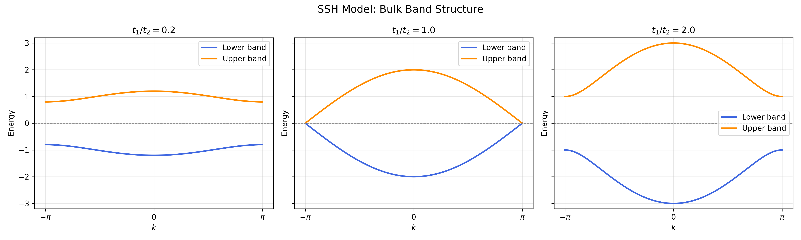

The direct band gap at each wave vector is defined by

$$
\Delta E(k)=E_+(k)-E_-(k).
$$

For positive hopping amplitudes, the minimum direct band gap occurs at $k=\pi$, giving

$$
\Delta_{\min}=2|t_1-t_2|.
$$

The gap therefore closes when

$$
t_1=t_2,
$$

and reopens as the hopping ratio moves away from this critical value.

Numerical calculations of the minimum band gap were compared with the analytical expression.

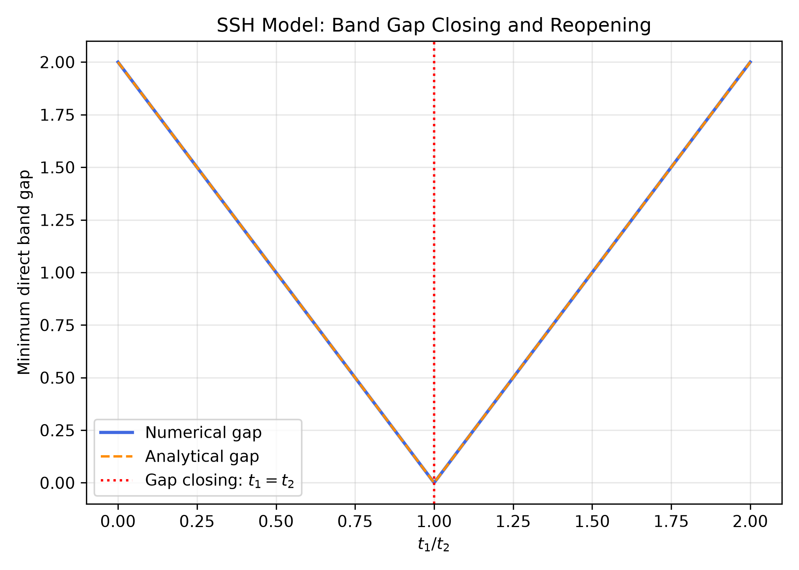

The numerical and analytical gap curves agree within floating-point precision. The Hermiticity of the Bloch Hamiltonian was also verified, and numerical eigenvalues agree with the analytical dispersion relation to approximately $10^{-15}$.

These results demonstrate how alternating hopping amplitudes modify the bulk energy spectrum and produce a band-gap closing and reopening.

However, the band gap alone does not distinguish the two gapped phases. Their topological properties are investigated in the next stage.

## Week 4: SSH Topology and Edge States

The fourth stage investigates the topological distinction between the two gapped phases of the SSH model.

The main objective is to establish a connection between the bulk winding number, boundary-localized states, and the finite-size energy spectrum.

### 4.1 Bulk Winding Number

The SSH Bloch Hamiltonian can be expressed using Pauli matrices as

$$
H(k)=d_x(k)\sigma_x+d_y(k)\sigma_y,
$$

where, for the negative-hopping convention used in this project,

$$
d_x(k)=-(t_1+t_2\cos k),
$$

$$
d_y(k)=-t_2\sin k.
$$

Equivalently, define the complex function

$$
q(k)=t_1+t_2e^{ik}.
$$

As $k$ traverses the first Brillouin zone, $q(k)$ traces a circle in the complex plane.

The circle has center $(t_1,0)$ and radius $|t_2|$.

The winding number measures how many times this closed trajectory winds around the origin:

$$
\nu=\frac{1}{2\pi}\int_{-\pi}^{\pi}\frac{d\theta(k)}{dk}\,dk,
$$

where

$$
\theta(k)=\arg[q(k)].
$$

For positive hopping amplitudes, the winding number is

$$
\nu=
\begin{cases}
1,&t_1<t_2,\\
0,&t_1>t_2.
\end{cases}
$$

When $t_1=t_2$, the trajectory passes through the origin, the bulk energy gap closes, and the winding number is undefined.

The winding number was calculated numerically using phase unwrapping to obtain the accumulated phase change over the Brillouin zone.

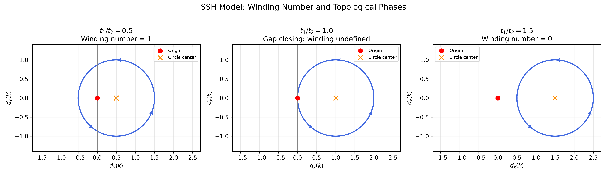

The numerical calculations reproduce the expected winding numbers for the trivial and topological phases.

The results demonstrate that the winding number cannot change continuously while the bulk gap remains open and the protecting chiral symmetry is preserved.

### 4.2 Open-Chain Edge States

To investigate the boundary properties of the SSH model, a finite chain with open boundary conditions was constructed.

For $N$ unit cells, the Hamiltonian contains $2N$ lattice sites, with alternating intracell and intercell hopping amplitudes.

Numerical calculations were performed using $N=40$, corresponding to an 80-site chain.

The eigenvalue problem is

$$
H|\psi\rangle=E|\psi\rangle.
$$

For $t_1<t_2$, two eigenstates with energies close to zero were identified.

Their probability distributions,

$$
P(n)=|\psi_n|^2,
$$

are strongly concentrated near the boundaries of the chain.

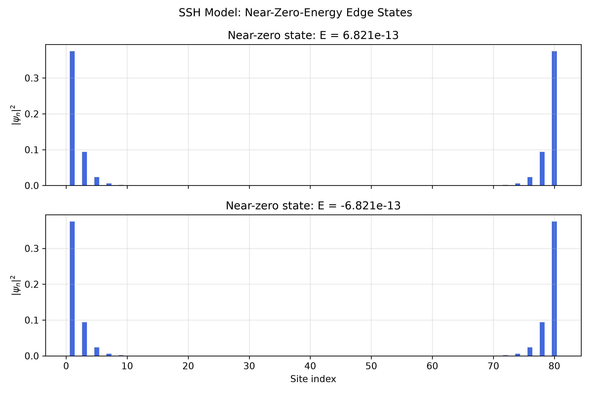

To distinguish the left- and right-localized modes, the position operator was projected onto the two-dimensional near-zero-energy subspace.

Diagonalizing the projected position operator produces states localized predominantly at opposite boundaries.

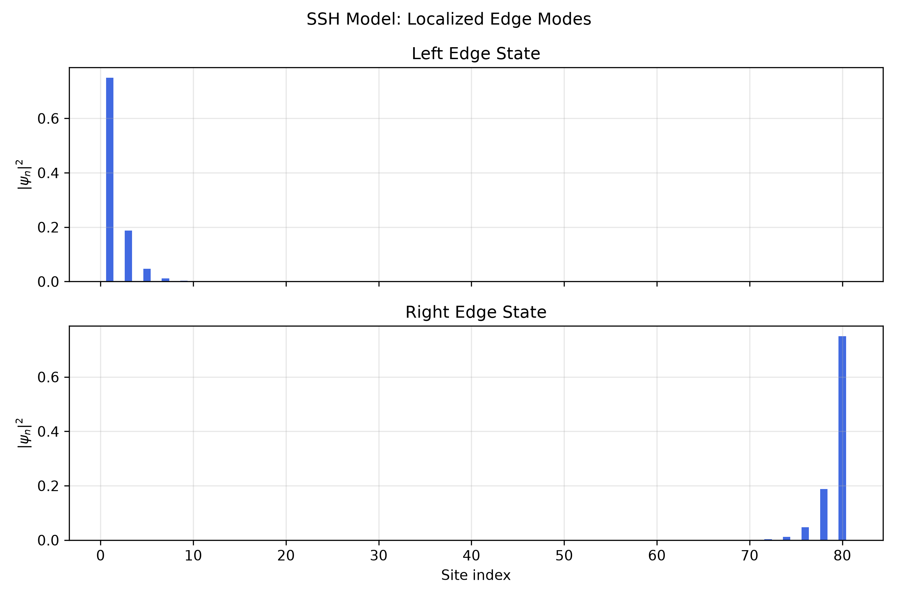

For $t_1=0.5$ and $t_2=1$, the numerical expectation values of the position operator were

$$
\langle X\rangle_L=1.6667,
$$

$$
\langle X\rangle_R=79.3333.
$$

Both states were numerically normalized to unity.

These results agree with the exponential localization predicted by the SSH model.

For a semi-infinite chain, the left-edge zero-energy mode satisfies

$$
a_n=\left(-\frac{t_1}{t_2}\right)^{n-1}a_1.
$$

Therefore,

$$
|a_n|^2\propto\left|\frac{t_1}{t_2}\right|^{2(n-1)}.
$$

When $|t_1|<|t_2|$, the probability density decays exponentially away from the boundary.

The corresponding localization length, measured in unit cells, is

$$
\xi=\frac{1}{\ln|t_2/t_1|}.
$$

As $t_1/t_2$ approaches 1 from below, the localization length increases, and the edge modes become less strongly confined to the boundaries.

### 4.3 Finite-Size Energy Splitting

For a finite SSH chain, the left- and right-localized modes can interact through the hopping terms of the Hamiltonian.

Consequently, the two near-zero-energy eigenstates generally have small but nonzero energies.

The approximate localized modes can be written as

$$
|L\rangle=C\sum_{n=1}^{N}r^{n-1}|A_n\rangle,
$$

$$
|R\rangle=C\sum_{n=1}^{N}r^{N-n}|B_n\rangle,
$$

where

$$
r=-\frac{t_1}{t_2}
$$

and the normalization factor satisfies

$$
C^2=\frac{1-r^2}{1-r^{2N}}.
$$

The effective coupling between the localized modes is

$$
\delta=\langle L|H|R\rangle=-C^2t_1r^{N-1}.
$$

Projecting the Hamiltonian onto the subspace spanned by these two modes gives

$$
H_{\mathrm{eff}}=
\begin{pmatrix}
0&\delta\\
\delta^*&0
\end{pmatrix}.
$$

The eigenvalues of this effective Hamiltonian are

$$
E_\pm=\pm|\delta|.
$$

For positive hopping amplitudes and $\rho=t_1/t_2<1$, the approximate near-zero eigenenergies are therefore

$$
\boxed{
|E_\pm|\approx
t_2\frac{(1-\rho^2)\rho^N}{1-\rho^{2N}}
}
$$

and the energy splitting is

$$
\Delta E=E_+-E_-\approx2|\delta|.
$$

The expression predicts exponentially small energy splitting as the chain length increases at fixed $\rho<1$.

To verify this result, the effective-theory approximation was compared with eigenvalues obtained from direct numerical diagonalization of the finite SSH Hamiltonian.

For $N=40$ and $t_2=1$, the results were:

| $t_1/t_2$ | Numerical $|E|$ | Approximate $|E|$ | Relative Error |
|---|---|---|---|
| 0.5 | 6.820308e-13 | 6.821210e-13 | 0.0132% |
| 0.7 | 3.247071e-07 | 3.247071e-07 | 9.143e-8% |
| 0.8 | 4.785222e-05 | 4.785221e-05 | 0.0000225% |
| 0.9 | 2.812550e-03 | 2.808981e-03 | 0.1270% |

The numerical results closely agree with the effective-theory prediction.

For very small energies, floating-point precision affects the relative error. As the hopping ratio approaches the transition point, the localized-mode approximation becomes less accurate because the edge states extend further into the bulk.

This comparison provides an independent analytical validation of the numerical edge-state calculations.

### 4.4 OBC Energy Spectrum and Edge Localization

The finite-chain energy spectrum was investigated as a function of the hopping ratio $t_1/t_2$.

For each parameter value, the 80-site open-chain Hamiltonian was diagonalized to obtain its eigenvalues and eigenvectors.

To quantify the spatial localization of each eigenstate, an edge probability weight was defined as

$$
P_{\mathrm{edge}}=
\sum_{n=1}^{m}|\psi_n|^2+
\sum_{n=2N-m+1}^{2N}|\psi_n|^2,
$$

where $m=6$ is the number of sites included near each boundary.

A high value of $P_{\mathrm{edge}}$ indicates that a large fraction of the state's probability density is concentrated near the boundaries.

The open-chain energy spectrum was plotted together with this localization measure.

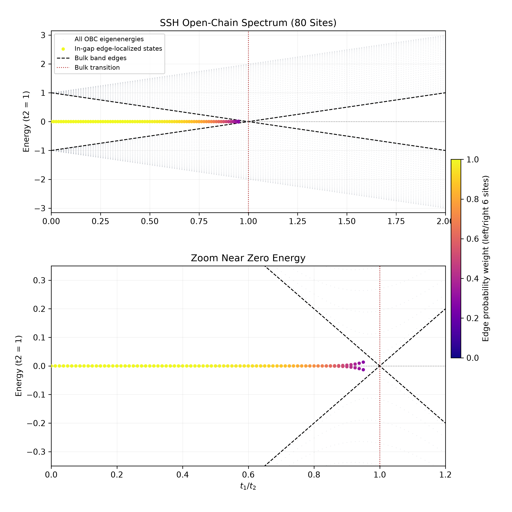

In the topological regime $t_1<t_2$, two near-zero-energy states appear inside the bulk energy gap and exhibit strong edge localization.

As $t_1/t_2$ approaches 1, their localization weakens and the finite-size energy splitting becomes more pronounced.

At the bulk transition point $t_1=t_2$, the infinite periodic system becomes gapless. The finite open chain retains discrete energy levels because of its finite size.

In the trivial regime $t_1>t_2$, the standard open SSH chain does not exhibit the corresponding topologically protected near-zero-energy edge modes.

The edge probability weight is a numerical localization diagnostic rather than a topological invariant. Its threshold is used only to highlight strongly localized states in the figure.

### 4.5 Bulk-Boundary Correspondence

The combined bulk and open-chain calculations demonstrate the correspondence between the SSH winding number and boundary-localized modes.

For the unit-cell convention and open-chain termination adopted in this project,

$$
\nu=1
\quad\Longleftrightarrow\quad
|t_1|<|t_2|,
$$

which corresponds to the regime supporting topological boundary modes.

By contrast,

$$
\nu=0
\quad\Longleftrightarrow\quad
|t_1|>|t_2|
$$

for positive hopping amplitudes, and the standard termination does not support the corresponding protected zero-energy edge modes.

The SSH Hamiltonian possesses chiral symmetry,

$$
\Gamma H\Gamma^{-1}=-H,
$$

which constrains nonzero energy eigenvalues to occur in positive-negative pairs.

For finite chains, the two boundary modes may hybridize, producing exponentially small nonzero energies without breaking chiral symmetry.

Therefore, the observation of $E\approx0$ alone is insufficient to establish a topological phase. The interpretation must also consider the bulk winding number, chiral symmetry, boundary conditions, and spatial localization of the eigenstates.

These numerical and analytical results provide a concrete demonstration of one-dimensional bulk-boundary correspondence.

## Numerical Methods

The calculations use Python, NumPy, and Matplotlib.

The principal numerical methods include:

- Construction of finite real-space tight-binding Hamiltonians.
- Diagonalization of Hermitian matrices using `numpy.linalg.eigh` and `numpy.linalg.eigvalsh`.
- Sampling and diagonalization of Bloch Hamiltonians over the Brillouin zone.
- Comparison between analytical and numerical energy spectra.
- Numerical calculation of winding numbers using phase unwrapping.
- Identification of edge-localized states through probability distributions and projected position operators.
- Parameter scans of open-chain spectra and edge probability weights.
- Comparison between finite-size numerical eigenvalues and effective-theory predictions.

Numerical results were checked against analytical expressions, Hermiticity conditions, eigenstate normalization, and finite-size behavior where applicable.


## Week 5: Two-Dimensional Chern Insulator

The fifth stage extends the study of topological lattice models from one dimension to two dimensions.

The main objective is to construct a two-dimensional two-band Hamiltonian, investigate its bulk energy spectrum, and identify the parameter values at which the band gap closes and reopens.

### 5.1 Qi-Wu-Zhang Model

We consider the Qi-Wu-Zhang (QWZ) model, a two-dimensional lattice model that exhibits topological phase transitions.

Each unit cell contains two internal degrees of freedom. With the lattice constant and hopping energy scale set to unity, the Bloch Hamiltonian is

$$
H(\mathbf{k})=
d_x(\mathbf{k})\sigma_x+
d_y(\mathbf{k})\sigma_y+
d_z(\mathbf{k})\sigma_z,
$$

where $\mathbf{k}=(k_x,k_y)$ and $\sigma_x,\sigma_y,\sigma_z$ are the Pauli matrices.

The components of the vector $\mathbf{d}(\mathbf{k})$ are

$$
d_x(\mathbf{k})=\sin k_x,
$$

$$
d_y(\mathbf{k})=\sin k_y,
$$

$$
d_z(\mathbf{k})=m+\cos k_x+\cos k_y,
$$

where $m$ is a tunable model parameter.

The Hamiltonian can be written explicitly as

$$
H(k_x,k_y)=
\begin{pmatrix}
d_z & d_x-id_y\\
d_x+id_y & -d_z
\end{pmatrix}.
$$

The model is defined over the two-dimensional first Brillouin zone,

$$
-\pi\leq k_x<\pi,\qquad
-\pi\leq k_y<\pi.
$$

### 5.2 Energy Bands and Gap-Closing Conditions

The energy eigenvalues are obtained by solving

$$
\det[H(\mathbf{k})-EI]=0.
$$

This gives two energy bands,

$$
E_\pm(\mathbf{k})
=\pm\sqrt{d_x^2+d_y^2+d_z^2}.
$$

Substituting the components of $\mathbf{d}(\mathbf{k})$,

$$
E_\pm(k_x,k_y)=
\pm\sqrt{
\sin^2 k_x+
\sin^2 k_y+
(m+\cos k_x+\cos k_y)^2
}.
$$

The direct band gap at each momentum is

$$
\Delta E(\mathbf{k})
=E_+(\mathbf{k})-E_-(\mathbf{k})
=2|\mathbf{d}(\mathbf{k})|.
$$

The gap closes when

$$
d_x=d_y=d_z=0.
$$

The first two conditions require

$$
\sin k_x=\sin k_y=0,
$$

so the possible gap-closing momenta are

$$
(k_x,k_y)=(0,0),\ (\pi,0),\ (0,\pi),\ (\pi,\pi),
$$

where momenta are understood modulo reciprocal lattice vectors.

The remaining condition,

$$
m+\cos k_x+\cos k_y=0,
$$

gives the critical parameter values

$$
\boxed{m_c=-2,\ 0,\ 2}.
$$

The corresponding gap-closing momenta are:

| Critical parameter | Gap-closing momentum |
|---|---|
| $m=-2$ | $(0,0)$ |
| $m=0$ | $(\pi,0)$ and $(0,\pi)$ |
| $m=2$ | $(\pi,\pi)$ |

These critical points are possible boundaries between distinct topological phases.

### 5.3 Numerical Band Structure

The QWZ Bloch Hamiltonian was implemented in Python using NumPy.

For each momentum point $(k_x,k_y)$, the $2\times2$ Hermitian Hamiltonian was diagonalized using numpy.linalg.eigvalsh.

An $80\times80$ momentum grid was used to sample the two-dimensional Brillouin zone.

The upper and lower energy bands were calculated for $m=-1$ and visualized as three-dimensional energy surfaces.

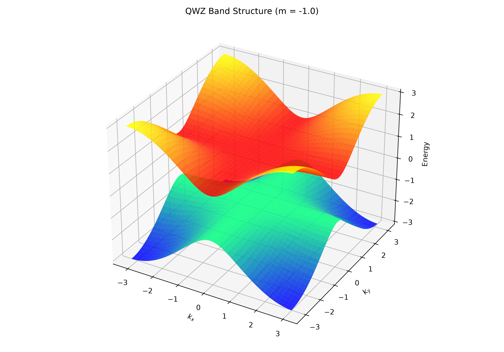

The two bands are symmetric about zero energy and remain separated throughout the Brillouin zone.

The calculated minimum bulk gap is

$$
\boxed{\Delta_{\mathrm{bulk}}=2}
$$

for $m=-1$.

This agrees with the analytical energy dispersion.

### 5.4 Bulk Gap Closing and Reopening

To investigate the effect of the model parameter $m$, the global minimum bulk gap was calculated over the two-dimensional Brillouin zone.

The minimum gap is defined as

```math
\Delta_{\mathrm{bulk}}(m)
=
\min_{k_x,k_y}
\left[
E_+(k_x,k_y;m)-E_-(k_x,k_y;m)
\right].
```

The parameter $m$ was varied from $-4$ to $4$, using 401 equally spaced values.

For each parameter value, the minimum energy separation between the two bands was calculated over the momentum grid.

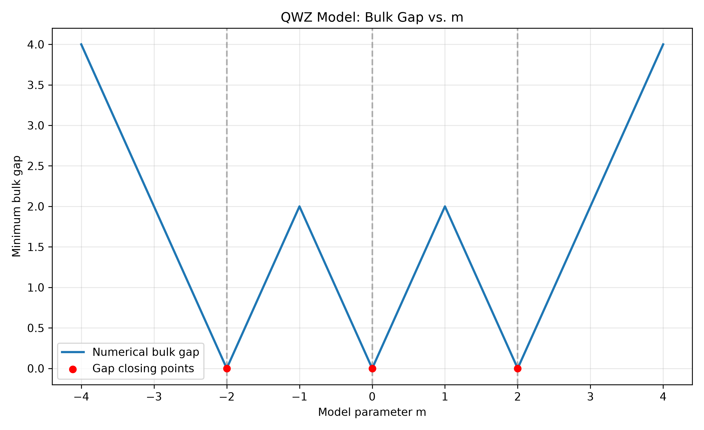

The numerical results show that the bulk gap closes at

$$
m=-2,\quad m=0,\quad m=2,
$$

in agreement with the analytical gap-closing conditions.

For this model, the minimum bulk gap can also be expressed analytically as

```math
\Delta_{\mathrm{bulk}}(m)
=
2\min\left\{
|m+2|,\ |m|,\ |m-2|
\right\}.
```

The calculated gap decreases to zero at each critical parameter and reopens as $m$ moves away from the transition points.

These results demonstrate how changing the Hamiltonian parameter can modify the bulk energy spectrum and produce gap-closing transitions.

### 5.5 Numerical Verification

The numerical implementation was checked against the analytical properties of the QWZ Hamiltonian.

First, the Hermiticity condition

$$
H(\mathbf{k})=H^\dagger(\mathbf{k})
$$

was verified numerically.

Second, the eigenvalues obtained using numpy.linalg.eigvalsh were compared with the analytical expression

```math
E_\pm(\mathbf{k})
=
\pm|\mathbf{d}(\mathbf{k})|.
```

The numerical and analytical eigenvalues agree within floating-point tolerance.

Furthermore, the calculated bulk gap at $m=-1$ agrees with the analytical value

$$
\Delta_{\mathrm{bulk}}(-1)=2.
$$

The parameter scan also reproduces the three analytically predicted gap-closing points.

These checks support the correctness of the numerical Hamiltonian and energy-spectrum calculations.

### 5.6 Physical Interpretation

The QWZ model demonstrates how a two-dimensional lattice Hamiltonian can undergo bulk gap closing and reopening as a model parameter changes.

The gap closes when the vector $\mathbf{d}(\mathbf{k})$ vanishes at particular momenta in the Brillouin zone.

For a gapped system, the normalized vector

```math
\hat{\mathbf{d}}(\mathbf{k})
=
\frac{\mathbf{d}(\mathbf{k})}
{|\mathbf{d}(\mathbf{k})|}
```

is well-defined throughout the Brillouin zone.

This normalized vector provides a geometric description of the two-band Hamiltonian and plays an important role in characterizing the topology of the occupied band.

A change in the Chern number requires the bulk gap to close during a continuous deformation of the Hamiltonian.

However, the bulk energy spectrum alone does not determine the Chern number.

The topological properties of the different gapped phases will be investigated in Week 6 through Berry curvature and Chern-number calculations.

The present results establish the two-dimensional bulk model and identify the critical parameters required for the subsequent topological analysis.


## Week 6: Berry Curvature and Chern Number

The sixth stage investigates the topological properties of the two-dimensional Qi-Wu-Zhang (QWZ) model through Berry curvature and Chern-number calculations.

The main objective is to characterize the geometry of Bloch eigenstates in momentum space, distinguish topologically trivial and nontrivial insulating phases, and verify the numerical stability and gauge invariance of the calculated topological invariants.

### 6.1 Berry Connection and Berry Curvature

For the two-band QWZ Hamiltonian introduced in Week 5,

```math
H(\mathbf{k})=
d_x(\mathbf{k})\sigma_x+
d_y(\mathbf{k})\sigma_y+
d_z(\mathbf{k})\sigma_z,
```

the normalized Bloch eigenstates satisfy

```math
H(\mathbf{k})|u_n(\mathbf{k})\rangle
=
E_n(\mathbf{k})|u_n(\mathbf{k})\rangle.
```

The momentum dependence of the eigenvectors contains geometric information that is not directly determined by the energy eigenvalues alone.

For an isolated energy band, the Berry connection is defined as

```math
\mathbf{A}_n(\mathbf{k})
=
i\langle u_n(\mathbf{k})|
\nabla_{\mathbf{k}}u_n(\mathbf{k})\rangle.
```

In two dimensions, its components are

```math
A_x(\mathbf{k})
=
i\left\langle u_n\middle|
\frac{\partial u_n}{\partial k_x}
\right\rangle,
```

```math
A_y(\mathbf{k})
=
i\left\langle u_n\middle|
\frac{\partial u_n}{\partial k_y}
\right\rangle.
```

The Berry curvature is obtained from the momentum-space derivatives of the Berry connection:

```math
\boxed{
\Omega_n(\mathbf{k})
=
\frac{\partial A_y}{\partial k_x}
-
\frac{\partial A_x}{\partial k_y}
}.
```

The Berry curvature measures the local geometric phase accumulated by a Bloch eigenstate around an infinitesimal closed loop in momentum space.

For a closed path $\mathcal{C}$, the Berry phase is

```math
\gamma_{\mathcal{C}}
=
\oint_{\mathcal{C}}
\mathbf{A}_n(\mathbf{k})\cdot d\mathbf{k}.
```

For a sufficiently small plaquette of area $\Delta k_x\Delta k_y$,

```math
\gamma_{\square}
\approx
\Omega_n(\mathbf{k})
\Delta k_x\Delta k_y.
```

Although the Berry connection depends on the phase convention of the eigenvectors, the Berry curvature is gauge invariant.

Under the gauge transformation

```math
|u_n(\mathbf{k})\rangle
\rightarrow
e^{i\chi(\mathbf{k})}
|u_n(\mathbf{k})\rangle,
```

the Berry connection transforms as

```math
\mathbf{A}_n'
=
\mathbf{A}_n-\nabla_{\mathbf{k}}\chi,
```

while the Berry curvature remains unchanged:

```math
\boxed{
\Omega_n'(\mathbf{k})
=
\Omega_n(\mathbf{k})
}.
```

The Chern number is defined by integrating the Berry curvature over the entire Brillouin zone:

```math
\boxed{
C_n=
\frac{1}{2\pi}
\int_{\mathrm{BZ}}
\Omega_n(\mathbf{k})\,d^2k
}.
```

For an isolated band, the Chern number is an integer-valued topological invariant.

### 6.2 Numerical Calculation Using the FHS Algorithm

The Berry curvature and Chern number were calculated numerically using the Fukui-Hatsugai-Suzuki (FHS) method.

This method computes gauge-invariant Berry fluxes from overlaps between neighboring Bloch eigenvectors, avoiding direct numerical differentiation of eigenvectors with arbitrary phases.

The two-dimensional Brillouin zone was discretized into an $N\times N$ periodic momentum grid:

```math
k_i=-\pi+\frac{2\pi i}{N},
\qquad i=0,\ldots,N-1.
```

The momentum spacing is

```math
\Delta k=\frac{2\pi}{N}.
```

At each momentum point, the $2\times2$ QWZ Hamiltonian was diagonalized using `numpy.linalg.eigh`.

The normalized eigenvector corresponding to the lower energy band was stored as

```math
|u_{ij}\rangle
=
|u_-(k_i,k_j)\rangle.
```

Normalized link variables were constructed from overlaps between neighboring eigenvectors:

```math
U_x(i,j)=
\frac{
\langle u_{ij}|u_{i+1,j}\rangle
}{
|\langle u_{ij}|u_{i+1,j}\rangle|
},
```

```math
U_y(i,j)=
\frac{
\langle u_{ij}|u_{i,j+1}\rangle
}{
|\langle u_{ij}|u_{i,j+1}\rangle|
}.
```

Periodic boundary conditions were imposed on the momentum-grid indices.

For each elementary plaquette, the gauge-invariant product of link variables is

```math
\boxed{
W_{ij}
=
U_x(i,j)
U_y(i+1,j)
U_x(i,j+1)^*
U_y(i,j)^*
}.
```

The corresponding discrete Berry flux is

```math
F_{ij}=-\mathrm{Arg}(W_{ij}).
```

where the negative sign follows from the convention

```math
\mathbf{A}_n
=
i\langle u_n|\nabla_{\mathbf{k}}u_n\rangle.
```

The discrete Berry curvature is approximated by

```math
\Omega_{ij}
\approx
\frac{F_{ij}}{(\Delta k)^2}.
```

Summing the Berry flux over the entire Brillouin zone gives the numerical Chern number:

```math
\boxed{
C_{\mathrm{FHS}}
=
\frac{1}{2\pi}
\sum_{i,j}F_{ij}
}.
```

The plaquette product is gauge invariant because the arbitrary phase factors associated with neighboring eigenvectors cancel around the closed loop.

The numerical implementation was developed in `src/topology.py`.

### 6.3 Berry Curvature Distribution

The Berry curvature of the lower energy band was calculated over an $80\times80$ momentum grid.

For the QWZ model,

```math
\mathbf{d}(\mathbf{k})=
\begin{pmatrix}
\sin k_x\\
\sin k_y\\
m+\cos k_x+\cos k_y
\end{pmatrix},
```

the lower-band Berry curvature can also be expressed analytically as

```math
\boxed{
\Omega_-(\mathbf{k})
=
\frac{1}{2}
\hat{\mathbf{d}}\cdot
\left(
\frac{\partial\hat{\mathbf{d}}}{\partial k_x}
\times
\frac{\partial\hat{\mathbf{d}}}{\partial k_y}
\right)
},
```

where

```math
\hat{\mathbf{d}}(\mathbf{k})
=
\frac{\mathbf{d}(\mathbf{k})}
{|\mathbf{d}(\mathbf{k})|}.
```

Equivalently,

```math
\Omega_-(k_x,k_y)
=
\frac{
\sin^2 k_x\cos k_y
+
\sin^2 k_y\cos k_x
+
d_z\cos k_x\cos k_y
}{
2(d_x^2+d_y^2+d_z^2)^{3/2}
}.
```

Two parameter regimes were investigated.

**Topological phase: $m=-1$**

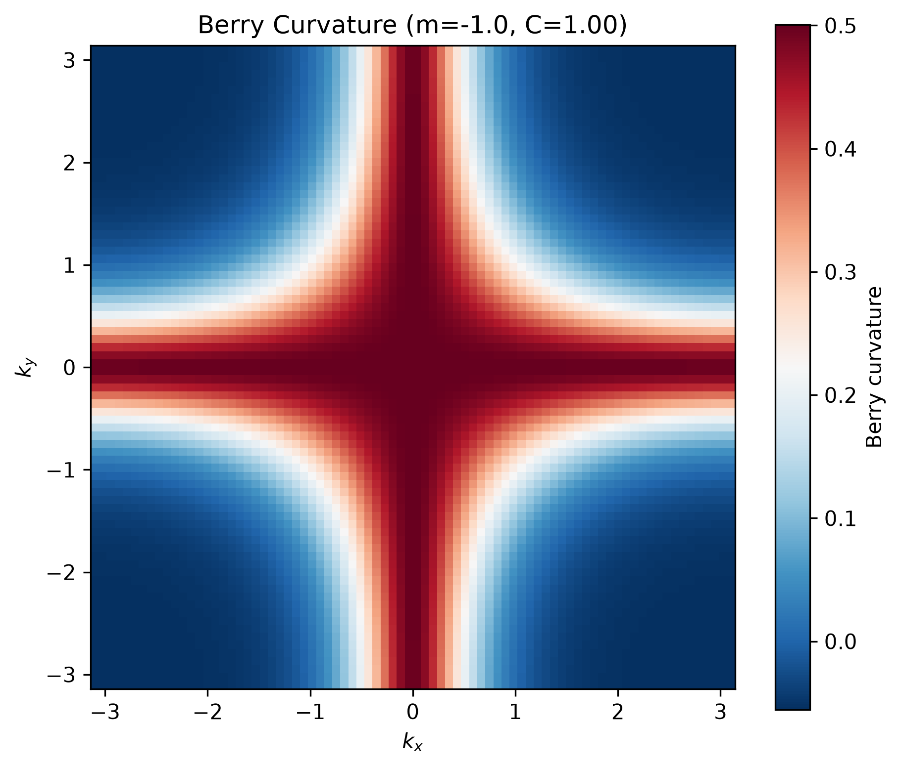

For $m=-1$, the Berry curvature exhibits a pronounced cross-shaped positive region near the momentum-space coordinate axes.

The corresponding Chern number is

```math
\boxed{C_-=+1}.
```

The nonzero Chern number indicates a topologically nontrivial lower energy band.

**Trivial phase: $m=3$**

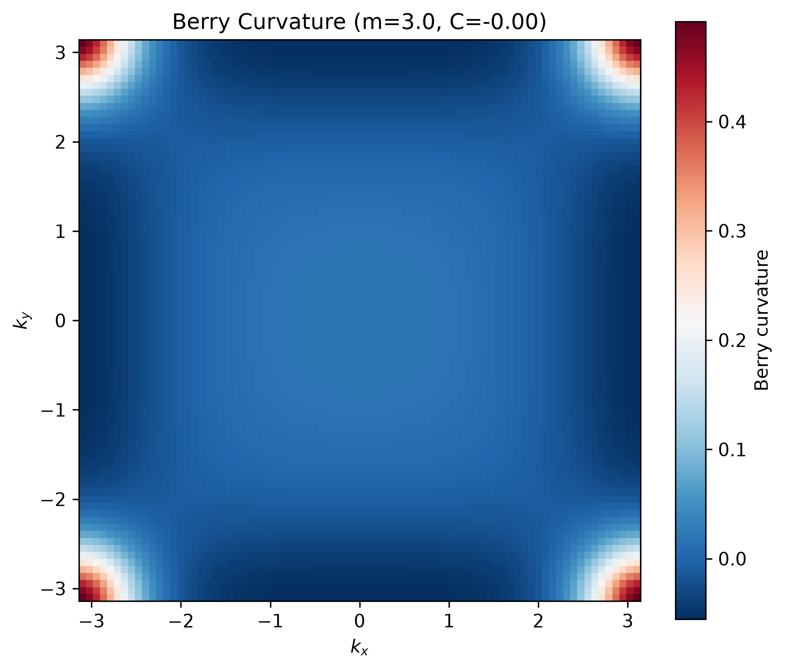

For $m=3$, the Berry curvature remains locally nonzero but contains positive and negative contributions that cancel upon integration over the Brillouin zone.

The resulting Chern number is

```math
\boxed{C_-=0}.
```

This comparison demonstrates that locally nonzero Berry curvature does not necessarily imply nontrivial global band topology.

The distinction is determined by the integrated Berry curvature rather than its value at an individual momentum point.

### 6.4 Chern Number and Topological Phase Transitions

To investigate the topological phase structure of the QWZ model, the mass parameter $m$ was varied from $-3$ to $3$.

For each gapped parameter value, the lower-band Chern number was calculated using the FHS algorithm.

The critical parameter values identified in Week 5 are

```math
\boxed{m_c=-2,\ 0,\ 2}.
```

At these values, the bulk energy gap closes and the Chern number of the isolated lower band becomes undefined.

The numerical phase diagram is shown below.

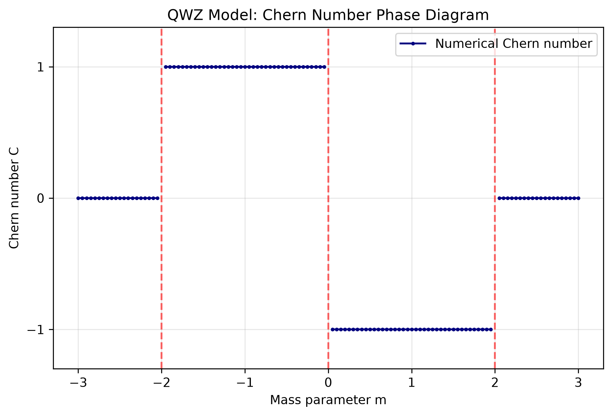

The calculated Chern numbers reproduce the expected phase structure:

```math
\boxed{
C_-(m)=
\begin{cases}
0, & m<-2,\\
+1, & -2<m<0,\\
-1, & 0<m<2,\\
0, & m>2.
\end{cases}
}
```

Representative numerical results are:

| Mass parameter | Numerical Chern number | Phase |
|---|---|---|
| $m=-3$ | 0 | Trivial |
| $m=-1$ | +1 | Topological |
| $m=1$ | -1 | Topological |
| $m=3$ | 0 | Trivial |

The Chern number remains constant within each gapped parameter region and changes only at the gap-closing transition points.

This behavior is consistent with the topological invariance of the mapping

```math
\hat{\mathbf{d}}:T^2\rightarrow S^2.
```

For the lower band, the Chern number equals the degree of this mapping under the sign convention adopted in this project.

The numerical results demonstrate that the two-dimensional QWZ model supports distinct topological insulating phases characterized by different integer Chern numbers.

### 6.5 Gauge Invariance Verification

To verify the gauge invariance of the FHS algorithm, an independent random phase was applied to every lower-band eigenvector:

```math
|u'_{ij}\rangle
=
e^{i\chi_{ij}}|u_{ij}\rangle.
```

The link variables, plaquette Berry fluxes, and Chern number were then recalculated.

For a link connecting two neighboring momentum points, the gauge transformation produces

```math
U_x'(i,j)
=
e^{i(\chi_{i+1,j}-\chi_{i,j})}
U_x(i,j).
```

Although individual link variables depend on the local phase convention, these phase factors cancel in the plaquette product:

```math
\boxed{
W'_{ij}=W_{ij}
}.
```

Consequently, the Berry flux and Chern number remain unchanged:

```math
F'_{ij}=F_{ij},
\qquad
C'=C.
```

The numerical results were:

| Quantity | Result |
|---|---|
| Original Chern number | 1.0 |
| Gauge-transformed Chern number | 1.0 |
| Chern number unchanged | True |
| Berry flux unchanged | True |
| Maximum Berry flux difference | $3.40\times10^{-16}$ |

The maximum difference in the calculated Berry flux is

```math
\boxed{
\max_{i,j}|F'_{ij}-F_{ij}|
=
3.40\times10^{-16}
}.
```

This difference is consistent with floating-point rounding error.

The test confirms that the numerical plaquette fluxes and Chern number are invariant under independent local phase transformations of the eigenvectors, within numerical precision.

### 6.6 Grid Convergence and Numerical Accuracy

The Chern number was calculated using three momentum-grid resolutions:

```math
N=20,\quad 40,\quad 80.
```

The results were:

| Grid size | $m=-3$ | $m=-1$ | $m=1$ | $m=3$ |
|---|---|---|---|---|
| $20\times20$ | 0 | +1 | -1 | 0 |
| $40\times40$ | 0 | +1 | -1 | 0 |
| $80\times80$ | 0 | +1 | -1 | 0 |

All tested grid resolutions produced identical integer Chern numbers for these gapped parameter values.

Since the FHS algorithm yields integer-valued results on a periodic grid under suitable conditions, additional convergence tests were performed for the local Berry curvature.

**Berry Curvature Convergence**

For $m=-1$, the numerical Berry curvature near the center of the Brillouin zone was compared with the analytical expression evaluated at the corresponding plaquette center.

The absolute error is defined as

```math
\epsilon_N=
|\Omega_{\mathrm{numerical}}
-
\Omega_{\mathrm{analytical}}|.
```

The numerical results were:

| Grid size | Numerical curvature | Analytical curvature | Absolute error |
|---|---|---|---|
| $20\times20$ | 0.50761234 | 0.49969697 | $7.91538\times10^{-3}$ |
| $40\times40$ | 0.50201868 | 0.49998099 | $2.03768\times10^{-3}$ |
| $80\times80$ | 0.50051171 | 0.49999881 | $5.12901\times10^{-4}$ |

The numerical Berry curvature approaches the analytical result as the grid resolution increases.

Doubling the grid resolution reduces the error by approximately a factor of four.

Since

```math
\Delta k=\frac{2\pi}{N},
```

the observed error reduction is consistent with second-order convergence:

```math
\boxed{
\epsilon_N\propto(\Delta k)^2
\propto N^{-2}
}.
```

This local convergence test provides an independent numerical check of the Berry-curvature calculation.

Together, the gauge-invariance and grid-convergence tests support the reliability of the FHS implementation for the investigated gapped parameter regimes.

### 6.7 Physical Interpretation

The calculations demonstrate the distinction between the local geometry of Bloch eigenstates and the global topology of an energy band.

Berry curvature characterizes the local geometric structure of quantum eigenstates in momentum space.

The Chern number is obtained by integrating this curvature over the entire Brillouin zone:

```math
C_-=
\frac{1}{2\pi}
\int_{\mathrm{BZ}}
\Omega_-(\mathbf{k})\,d^2k.
```

For a gapped two-band Hamiltonian, the normalized vector

```math
\hat{\mathbf{d}}(\mathbf{k})
=
\frac{\mathbf{d}(\mathbf{k})}
{|\mathbf{d}(\mathbf{k})|}
```

defines a continuous mapping from the Brillouin-zone torus $T^2$ to the unit sphere $S^2$.

The Chern number measures the degree of this mapping for the lower band.

A continuous deformation of the Hamiltonian cannot change this integer invariant while the bulk energy gap remains open.

When the gap closes,

```math
|\mathbf{d}(\mathbf{k})|=0,
```

the normalized mapping becomes undefined at the degeneracy point, allowing the topological invariant to change across the transition.

The numerical phase diagram verifies this behavior at

```math
m=-2,\quad m=0,\quad m=2.
```

The comparison between $m=-1$ and $m=3$ further demonstrates that two gapped systems can exhibit different global topological properties despite both possessing locally nonzero Berry curvature.

These results establish the relationship between Bloch-state geometry, Berry curvature, and Chern-number quantization in a two-dimensional lattice model.

They also provide the bulk topological characterization required for Week 7, where strip geometries and chiral edge states will be investigated to demonstrate bulk-edge correspondence.


## Week 7: Bulk–Edge Correspondence

The seventh stage investigates the relationship between the bulk topology of the two-dimensional Qi-Wu-Zhang (QWZ) model and the appearance of boundary-localized electronic states.

The main objective is to demonstrate bulk-edge correspondence by constructing a finite strip Hamiltonian, calculating its energy spectrum, identifying edge-localized eigenstates, and comparing topologically trivial and nontrivial parameter regimes.

The bulk Chern numbers calculated in Week 6 provide the topological characterization required for this analysis.

### 7.1 Strip Geometry and Boundary Conditions

In Week 5 and Week 6, the QWZ model was studied using periodic boundary conditions in both spatial directions.

To investigate boundary states, the system is now constructed in a strip geometry.

Open boundary conditions are imposed along the x direction, while periodic boundary conditions are maintained along the y direction.

The system therefore contains a finite number of unit cells along x but retains translational symmetry along y.

Consequently, the momentum component along y remains a good quantum number, whereas the x direction must be represented using real-space lattice indices.

The original two-dimensional Bloch Hamiltonian is

```math
H(k_x,k_y)
=
\sin k_x\,\sigma_x
+
\sin k_y\,\sigma_y
+
(m+\cos k_x+\cos k_y)\sigma_z.
```

Under strip boundary conditions, the Hamiltonian becomes

```math
H_{\mathrm{strip}}(k_y).
```

For a strip containing a finite number of unit cells along x, with two internal degrees of freedom per unit cell, the Hamiltonian dimension is

```math
\dim H_{\mathrm{strip}}=2N_x.
```

Numerical calculations were performed using

```math
N_x=40,
```

corresponding to an 80-dimensional Hermitian Hamiltonian.

### 7.2 Construction of the Strip Hamiltonian

The strip Hamiltonian was constructed by separating the original Bloch Hamiltonian into onsite and nearest-neighbor coupling terms along the x direction.

The onsite block is

```math
A(k_y)
=
\sin k_y\,\sigma_y
+
(m+\cos k_y)\sigma_z.
```

Using the Fourier identities

```math
\sin k_x
=
\frac{e^{ik_x}-e^{-ik_x}}{2i},
```

```math
\cos k_x
=
\frac{e^{ik_x}+e^{-ik_x}}{2},
```

the nearest-neighbor coupling block can be expressed as

```math
T
=
\frac{1}{2}
(\sigma_z-i\sigma_x).
```

With the convention that T occupies the upper off-diagonal block, the original Bloch Hamiltonian can be reconstructed as

```math
H(k_x,k_y)
=
A(k_y)
+
Te^{ik_x}
+
T^\dagger e^{-ik_x}.
```

The complete strip Hamiltonian is therefore

```math
H_{\mathrm{strip}}(k_y)
=
\begin{pmatrix}
A & T & 0 & \cdots & 0\\
T^\dagger & A & T & \cdots & 0\\
0 & T^\dagger & A & \ddots & 0\\
\vdots & \vdots & \ddots & \ddots & T\\
0 & 0 & 0 & T^\dagger & A
\end{pmatrix}.
```

Here, each matrix element represents a two-dimensional block acting on the internal degrees of freedom of a unit cell.

The absence of coupling between the first and last unit cells implements open boundary conditions along x.

The Hamiltonian satisfies the Hermiticity condition

```math
H_{\mathrm{strip}}(k_y)
=
H_{\mathrm{strip}}^\dagger(k_y).
```

The matrix was implemented in `src/strip_geometry.py` and diagonalized using `numpy.linalg.eigh`.

### 7.3 Edge Energy Spectrum

The energy spectrum of the finite strip was calculated by solving the eigenvalue equation

```math
H_{\mathrm{strip}}(k_y)
|\psi_n(k_y)\rangle
=
E_n(k_y)|\psi_n(k_y)\rangle.
```

For each momentum value, the 80-dimensional Hamiltonian produces 80 energy eigenvalues.

The resulting energy spectrum was calculated over the first Brillouin zone.

To distinguish bulk-like and boundary-localized eigenstates, the spatial probability distribution of each eigenvector was examined.

The probability associated with the x-th unit cell is defined as

```math
P_n(x)
=
\sum_{\alpha=1}^{2}
|\psi_{n,x,\alpha}|^2,
```

where the index alpha labels the two internal degrees of freedom.

The edge probability weight was defined as

```math
P_{\mathrm{edge}}^{(n)}
=
\sum_{x=1}^{n_e}P_n(x)
+
\sum_{x=N_x-n_e+1}^{N_x}P_n(x).
```

In the numerical calculations, the number of unit cells included near each boundary was chosen as

```math
n_e=6.
```

The edge probability weight measures the fraction of the eigenstate probability concentrated near the two boundaries.

Values close to unity indicate strong boundary localization, whereas smaller values indicate a more extended spatial distribution.

The energy spectrum was plotted with the edge probability weight represented by the color of each eigenstate.

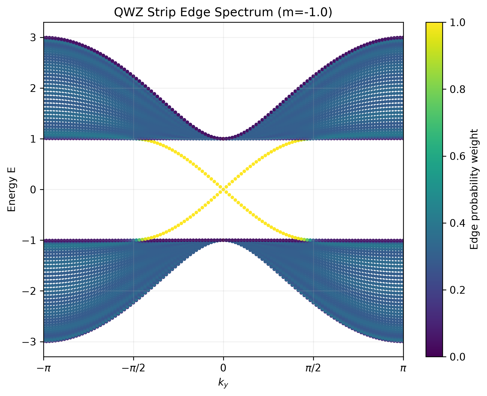

For the topological parameter regime,

```math
m=-1,\qquad C=+1,
```

the spectrum exhibits two strongly edge-localized branches crossing the bulk energy gap.

These branches have opposite slopes and intersect near zero energy.

The surrounding bulk-like eigenstates form upper and lower energy bands, separated by a finite bulk gap.

The appearance of gap-crossing boundary-localized branches provides numerical evidence for the existence of chiral edge modes.

### 7.4 Edge-State Wavefunction Localization

To verify the spatial character of the states appearing inside the bulk energy gap, representative eigenvectors were selected and their probability distributions were calculated.

The momentum and model parameter were fixed at

```math
k_y=\frac{\pi}{6},
\qquad
m=-1.
```

At this momentum, two states were identified with energies

```math
E_L=+0.5,
```

```math
E_R=-0.5.
```

Their spatial probability distributions were computed from the eigenvector components and summed over the two internal degrees of freedom.

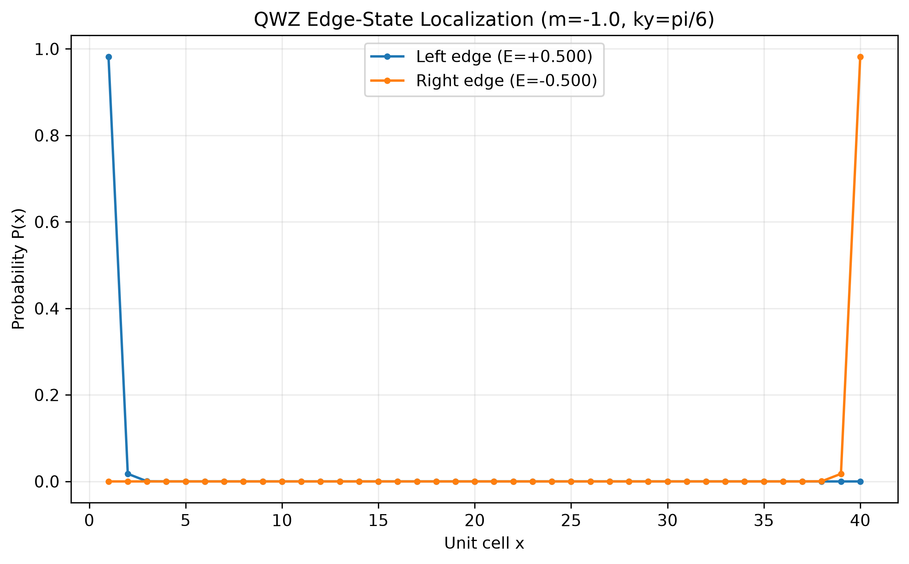

The numerical results show that the positive-energy state is strongly localized near the left boundary, while the negative-energy state is strongly localized near the right boundary.

Both states exhibit rapidly decaying probability distributions away from their corresponding boundaries.

The localization can also be understood analytically.

For the selected strip Hamiltonian, the left-edge state has an exponential spatial dependence of the form

```math
\psi_L(x)\propto r^{x-1},
```

where

```math
r=-(m+\cos k_y).
```

The corresponding probability distribution satisfies

```math
P_L(x)\propto |r|^{2(x-1)}.
```

Similarly, the right-edge probability distribution satisfies

```math
P_R(x)\propto |r|^{2(N_x-x)}.
```

The edge states are normalizable and localized when

```math
|r|<1.
```

For the parameters used in the calculation,

```math
r
=
1-\frac{\sqrt{3}}{2}
\approx0.133975.
```

Therefore, the probability ratio between neighboring unit cells is approximately

```math
\frac{P_L(x+1)}{P_L(x)}
=
|r|^2
\approx0.01795.
```

This indicates that the probability decreases to approximately 1.8% of its previous value when moving one unit cell into the bulk.

In the semi-infinite approximation, the normalized probability at the first unit cell is

```math
P_L(1)\approx1-|r|^2.
```

Substituting the numerical value gives

```math
P_L(1)\approx0.98205.
```

This agrees with the pronounced boundary-localized peaks observed in the numerical probability distributions.

The eigenvector analysis therefore confirms that the gap-crossing states identified in the energy spectrum are genuine boundary-localized states rather than extended bulk states.

### 7.5 Chiral Edge-State Dispersion

For the chosen QWZ Hamiltonian and strip convention, the edge-state energy dispersions can be expressed analytically as

```math
E_L(k_y)=+\sin k_y,
```

```math
E_R(k_y)=-\sin k_y.
```

The localized edge solutions exist in the momentum region satisfying

```math
|m+\cos k_y|<1.
```

For the topological phase with the selected mass parameter,

```math
m=-1,
```

this condition becomes

```math
-\frac{\pi}{2}<k_y<\frac{\pi}{2}.
```

Within this interval, the edge-state branches traverse the bulk energy gap.

At the center of the Brillouin zone,

```math
k_y=0,
```

the two edge-state energies satisfy

```math
E_L(0)=E_R(0)=0.
```

Numerical diagonalization of the strip Hamiltonian at this momentum gives two near-zero-energy eigenstates.

For the 80-dimensional Hamiltonian, the minimum absolute eigenenergy was

```math
|E|_{\min}
\approx
6.16\times10^{-33}.
```

Two eigenstates were identified within the near-zero-energy numerical threshold.

The propagation direction of an edge mode is determined by the group velocity,

```math
v_y
=
\frac{1}{\hbar}
\frac{\partial E}{\partial k_y},
```

with the momentum convention and lattice units appropriately restored when using physical units.

For the two edge branches,

```math
\frac{\partial E_L}{\partial k_y}
=
+\cos k_y,
```

```math
\frac{\partial E_R}{\partial k_y}
=
-\cos k_y.
```

Near the zero-energy crossing, the two group velocities have opposite signs.

Consequently, the left- and right-localized edge states propagate in opposite directions along the strip.

This behavior is characteristic of chiral edge modes in a two-dimensional Chern insulator.

### 7.6 Comparison Between Topological and Trivial Phases

To establish the relationship between bulk topology and edge states, the strip spectra were compared for two different mass parameters.

The first parameter corresponds to a topologically nontrivial bulk phase:

```math
m=-1,\qquad C=+1.
```

The second parameter corresponds to a topologically trivial bulk phase:

```math
m=3,\qquad C=0.
```

For each parameter, the strip Hamiltonian was diagonalized over the Brillouin zone, and the edge probability weight was calculated for every eigenstate.

The resulting spectra are shown below.

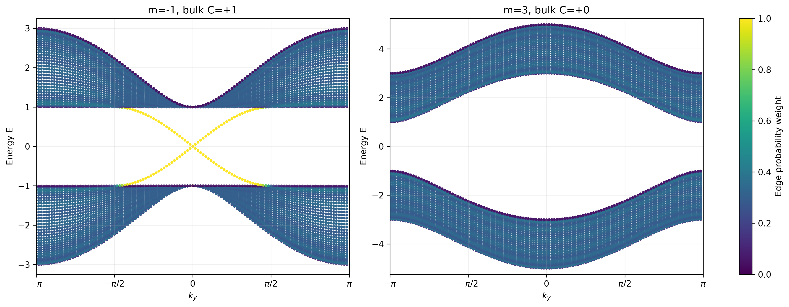

For the topological phase, the numerical spectrum exhibits two boundary-localized branches traversing the bulk energy gap.

These branches connect the upper and lower bulk-like energy bands and show strong localization near the opposite boundaries.

For the trivial phase, the spectrum remains gapped, but no corresponding gap-crossing chiral edge branches are observed.

The comparison is summarized below.

| Property | Topological phase | Trivial phase |
|---|---|---|
| Mass parameter | -1 | 3 |
| Bulk Chern number | +1 | 0 |
| Bulk energy gap | Open | Open |
| Gap-crossing edge branches | Present | Absent |
| Boundary-localized chiral modes | Present | Absent in the studied termination |

The results demonstrate that the presence of a bulk energy gap alone does not determine whether a system supports topologically protected boundary modes.

Instead, the global topological invariant of the occupied band distinguishes the two phases.

The absence of gap-crossing edge modes in the trivial regime is consistent with its vanishing bulk Chern number for the chosen boundary termination.

### 7.7 Numerical Verification

Several numerical checks were performed to validate the strip Hamiltonian and edge-state calculations.

**Hamiltonian Dimensions and Hermiticity**

For the selected system size,

```math
N_x=40,
```

the Hamiltonian has dimensions

```math
80\times80.
```

The numerical Hermiticity condition was verified:

```math
H_{\mathrm{strip}}
=
H_{\mathrm{strip}}^\dagger.
```

The corresponding numerical test returned `True`.

**Near-Zero-Energy States**

For the topological phase at zero transverse momentum,

```math
m=-1,\qquad k_y=0,
```

two near-zero-energy eigenstates were obtained.

Their energies are consistent with the analytical edge-state dispersion.

**Edge-State Localization**

For the momentum

```math
k_y=\frac{\pi}{6},
```

the numerical eigenvalues agree with the analytical predictions:

```math
E_L=+\sin\left(\frac{\pi}{6}\right)=+0.5,
```

```math
E_R=-\sin\left(\frac{\pi}{6}\right)=-0.5.
```

The edge probability weights calculated over the six unit cells nearest the corresponding boundaries were approximately unity.

The probability distributions also agree with the expected exponential localization.

**Bulk Chern Number Verification**

The bulk Chern numbers were recalculated using the FHS algorithm developed in Week 6.

The numerical results reproduce

```math
C(-1)=+1,
```

```math
C(3)=0.
```

**Trivial-Phase Spectrum Check**

For the trivial phase, no near-zero-energy states were found at zero transverse momentum.

The corresponding numerical verification confirmed

```math
\min_n |E_n(k_y=0;m=3)|>1.
```

These calculations support the consistency of the bulk topological characterization, finite-strip energy spectra, and spatial localization of the edge states.

### 7.8 Physical Interpretation and Bulk–Edge Correspondence

The results establish a numerical connection between the bulk Chern number and the appearance of chiral boundary modes in the two-dimensional QWZ model.

In Week 6, the bulk topology was characterized using the Chern number,

```math
C
=
\frac{1}{2\pi}
\int_{\mathrm{BZ}}
\Omega(\mathbf{k})\,d^2k.
```

For the topological parameter regime,

```math
C=+1,
```

the strip geometry exhibits gap-crossing edge branches whose eigenvectors are localized near the opposite boundaries.

The corresponding group velocities have opposite signs, indicating counterpropagating modes on the two different edges.

For the trivial parameter regime,

```math
C=0,
```

the strip remains gapped and does not exhibit the corresponding protected gap-crossing chiral edge modes.

The bulk-edge correspondence relates the bulk Chern number to the net number of chiral edge branches, with the sign determined by the edge orientation and the Hamiltonian convention.

In a finite strip, the two spatially separated boundaries support modes propagating in opposite directions.

The numerical calculations therefore provide evidence for the relationship

```math
\boxed{
\text{Nonzero bulk Chern number}
\Longrightarrow
\text{Chiral boundary modes}
}.
```

More precisely, the Chern number determines the net chirality of the boundary modes, rather than the total number of possible boundary-localized eigenstates.

The combined results from Week 5, Week 6, and Week 7 establish the following physical sequence:

```math
\boxed{
H(\mathbf{k})
\longrightarrow
E_n(\mathbf{k})
\longrightarrow
\text{Band-gap closing}
\longrightarrow
C
\longrightarrow
\text{Chiral edge states}
}.
```

The study demonstrates how a topological invariant calculated from an infinite periodic bulk Hamiltonian predicts observable boundary properties when open boundaries are introduced.

Together with the one-dimensional SSH calculations from Week 3 and Week 4, these results provide a numerical investigation of topological phases and bulk-boundary correspondence in both one-dimensional and two-dimensional quantum lattice models.


